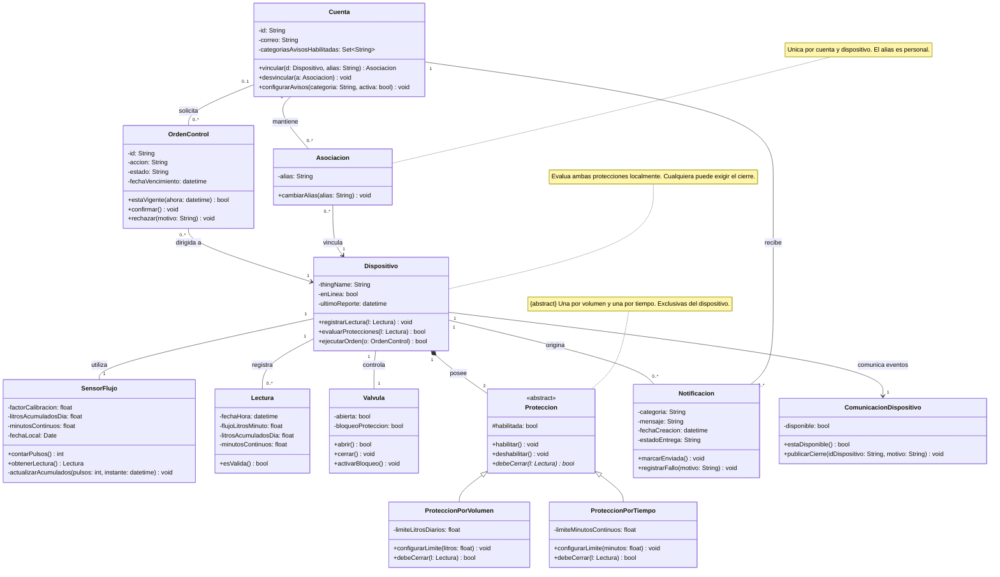

# Diagrama de clases de AwaLume

**Autor:** Marco Villegas Xanthakis

**Fecha:** 17 de noviembre de 2026

Modelo de diseño que integra las correcciones identificadas al construir el [diagrama de secuencia de CU-05](diagrama-secuencia.md) y revisar la [especificación de requisitos](../especificacion-requisitos.md). Representa responsabilidades del sistema completo, no un único proceso ni clases cuya implementación se haya verificado.

## Código Mermaid

    classDiagram
    direction TB

    class Cuenta {
        -id: String
        -correo: String
        -categoriasAvisosHabilitadas: Set~String~
        +vincular(d: Dispositivo, alias: String) Asociacion
        +desvincular(a: Asociacion) void
        +configurarAvisos(categoria: String, activa: bool) void
    }

    class Asociacion {
        -alias: String
        +cambiarAlias(alias: String) void
    }

    class Dispositivo {
        -thingName: String
        -enLinea: bool
        -ultimoReporte: datetime
        +registrarLectura(l: Lectura) void
        +evaluarProtecciones(l: Lectura) bool
        +ejecutarOrden(o: OrdenControl) bool
    }

    class SensorFlujo {
        -factorCalibracion: float
        -litrosAcumuladosDia: float
        -minutosContinuos: float
        -fechaLocal: Date
        +contarPulsos() int
        +obtenerLectura() Lectura
        -actualizarAcumulados(pulsos: int, instante: datetime) void
    }

    class Lectura {
        -fechaHora: datetime
        -flujoLitrosMinuto: float
        -litrosAcumuladosDia: float
        -minutosContinuos: float
        +esValida() bool
    }

    class Valvula {
        -abierta: bool
        -bloqueoProteccion: bool
        +abrir() bool
        +cerrar() void
        +activarBloqueo() void
    }

    class OrdenControl {
        -id: String
        -accion: String
        -estado: String
        -fechaVencimiento: datetime
        +estaVigente(ahora: datetime) bool
        +confirmar() void
        +rechazar(motivo: String) void
    }

    class Proteccion {
        <<abstract>>
        #habilitada: bool
        +habilitar() void
        +deshabilitar() void
        +debeCerrar(l: Lectura) bool*
    }

    class ProteccionPorVolumen {
        -limiteLitrosDiarios: float
        +configurarLimite(litros: float) void
        +debeCerrar(l: Lectura) bool
    }

    class ProteccionPorTiempo {
        -limiteMinutosContinuos: float
        +configurarLimite(minutos: float) void
        +debeCerrar(l: Lectura) bool
    }

    class Notificacion {
        -categoria: String
        -mensaje: String
        -fechaCreacion: datetime
        -estadoEntrega: String
        +marcarEnviada() void
        +registrarFallo(motivo: String) void
    }

    class ComunicacionDispositivo {
        -disponible: bool
        +estaDisponible() bool
        +publicarCierre(idDispositivo: String, motivo: String) void
    }

    Cuenta "1" -- "0..*" Asociacion : mantiene
    Asociacion "0..*" --> "1" Dispositivo : vincula
    Cuenta "0..1" -- "0..*" OrdenControl : solicita
    OrdenControl "0..*" --> "1" Dispositivo : dirigida a
    Cuenta "1" -- "0..*" Notificacion : recibe
    Dispositivo "1" -- "0..*" Notificacion : origina
    Dispositivo "1" -- "1" SensorFlujo : utiliza
    Dispositivo "1" -- "0..*" Lectura : registra
    Dispositivo "1" -- "1" Valvula : controla
    Dispositivo "1" *-- "2" Proteccion : posee
    Dispositivo "1" --> "1" ComunicacionDispositivo : comunica eventos
    Proteccion <|-- ProteccionPorVolumen
    Proteccion <|-- ProteccionPorTiempo

    note for Asociacion "Unica por cuenta y dispositivo. El alias es personal."
    note for Proteccion "{abstract} Una por volumen y una por tiempo. Exclusivas del dispositivo."
    note for Dispositivo "Evalua ambas protecciones localmente. Cualquiera puede exigir el cierre."

## Correcciones incorporadas

1. **Avisos por cuenta y categoría.** Se trasladan las preferencias y `configurarAvisos` de Asociacion a Cuenta, conforme a RF-022 y CU-10. Un conjunto de categorías representa mejor las preferencias que un único booleano. Notificacion identifica su categoría; el alias permanece en Asociacion.
2. **Comunicación del dispositivo.** Se añade ComunicacionDispositivo con `estaDisponible()` y `publicarCierre(...)`, y su asociación con Dispositivo. Son las operaciones receptoras de los mensajes de la secuencia. La publicación es asíncrona y no condiciona el cierre local; disponibilidad no garantiza entrega.
3. **Origen de los acumulados.** SensorFlujo representa el componente de medición del firmware, no solo el sensor físico. Conserva litros diarios, minutos continuos y fecha local; actualiza esos valores y devuelve una instantánea Lectura. Al cambiar el día se reinicia el acumulado del nuevo día; al terminar un episodio sin flujo, el siguiente empieza con duración cero. La persistencia y restauración obedecen a RNF-CON-002.
4. **Control local sin cuenta remota.** Se ajusta a `0..1` el extremo Cuenta de OrdenControl: una orden remota corresponde a una cuenta autenticada y asociada, mientras que una orden local puede no tener cuenta remota, conforme a RF-015 y CU-07. Esto no elimina la autorización local: requiere acceso a la red protegida y comprobación de identidad del equipo. Una cuenta puede solicitar cero o muchas órdenes. El cierre automático se ejecuta directamente por las protecciones y no necesita crear una orden de usuario.
5. **Nota sobre el cierre.** Se distingue la evaluación automática de protecciones de las solicitudes de usuarios. Una cuenta asociada puede solicitar control remoto autorizado; el acceso local tiene sus propias comprobaciones. Ninguna apertura puede ignorar un bloqueo local.

## Relaciones y reglas de negocio

- Cada asociación pertenece a una cuenta y un dispositivo. La combinación cuenta-dispositivo es única; quitarla no elimina el equipo, su historial ni las asociaciones de otras cuentas.
- Cada dispositivo tiene dos configuraciones de protección: una por volumen y otra por tiempo. Ambas pueden habilitarse independientemente. Cero desactiva solo la variante correspondiente y un límite negativo se rechaza.
- Las protecciones son partes exclusivas del dispositivo: en este modelo su eliminación definitiva elimina esas configuraciones. Desasociar una cuenta no equivale a eliminar el dispositivo. Esta regla de composición no introduce una nueva función de borrado para el usuario.
- Sensor y válvula usan asociación simple: sustituir el dispositivo lógico no implica destruir físicamente esos componentes.
- Cada Notificacion representa un aviso para una sola cuenta. Un mismo evento puede originar varias notificaciones, una por destinatario elegible, según asociación y preferencias vigentes. Comunicar el evento desde el firmware y entregar el aviso al teléfono son responsabilidades diferentes.
- `abierta` representa el estado reportado, no una medición independiente de posición mecánica. La protección requiere energía, sensor y actuador operativos; las pruebas físicas deben verificar que se interrumpe el paso de agua.

## Concordancia con la secuencia de CU-05

| Mensaje de la secuencia | Clase que declara la operación |
|---|---|
| `obtenerLectura()` | SensorFlujo |
| `registrarLectura(l)` | Dispositivo |
| `evaluarProtecciones(l)` | Dispositivo |
| `debeCerrar(l)` | ProteccionPorVolumen y ProteccionPorTiempo, especializando Proteccion |
| `activarBloqueo()` y `cerrar()` | Valvula |
| `estaDisponible()` y `publicarCierre(idDispositivo, motivo)` | ComunicacionDispositivo |

Las referencias entre SensorFlujo, protecciones y Lectura también aparecen en los tipos de parámetros y retornos. Para mantener legible el dibujo no se duplican como flechas de dependencia todas las referencias transitorias.

## Ejemplo de comprobación

Marco y Ana tienen cuentas distintas asociadas a AW-001. Marco lo llama “Edificio norte” y Ana “Cisterna”; cada cuenta conserva sus propias categorías de avisos. AW-001 tiene una protección de 1,000 litros diarios y otra de 30 minutos continuos. Una lectura de 1,005 litros y 10 minutos exige cerrar por volumen, aunque la protección de tiempo no se haya activado. El cierre se mantiene sin Internet. Si Ana se desasocia, el equipo, su historial y la asociación de Marco permanecen.

La exportación CSV de SC-001 continúa como cambio propuesto y no se incorpora aquí como funcionalidad ya aceptada. Este modelo se integra con la arquitectura descrita en [diagramas.md](diagramas.md).
