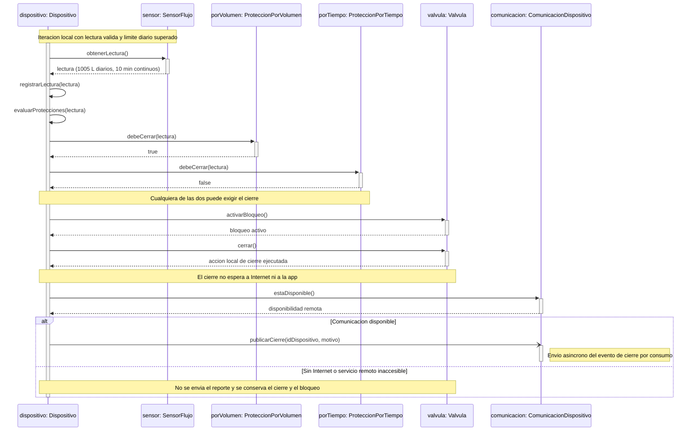
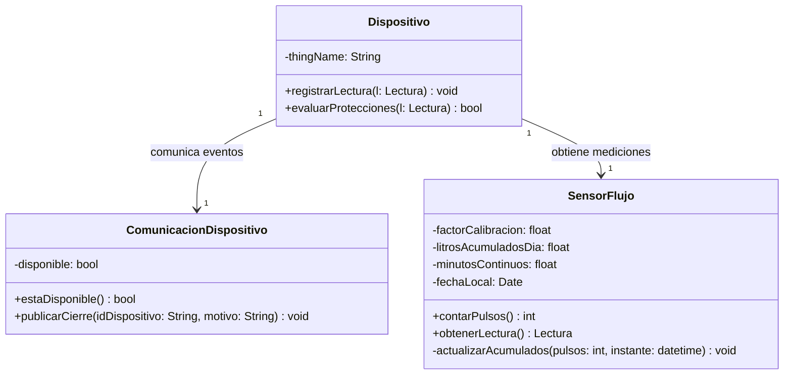

# Diagrama de secuencia de AwaLume

**Autor:** Marco Villegas Xanthakis

**Fecha:** 16 de noviembre de 2026

## Caso de uso elegido

**CU-05: Limitar una pérdida de agua automáticamente**, descrito en la [especificación de requisitos](../especificacion-requisitos.md). Es el caso principal porque la utilidad de las estadísticas y los avisos no sustituye la protección local frente a un consumo excesivo.

Se representa una iteración del firmware: obtiene una lectura, evalúa las dos protecciones y cierra la válvula al superar un límite. El flujo alternativo es la falta de comunicación remota, que no debe impedir el cierre. Corresponde al alterno 3a de CU-05 y a RNF-CON-001.

**Condiciones del escenario:** hay energía, sensor y actuador operativos; la lectura es válida; la protección diaria está habilitada en 1,000 L y se registran 1,005 L. La protección de tiempo está habilitada en 30 minutos y la lectura indica 10 minutos continuos. Por tanto, la primera devuelve verdadero y la segunda falso. La válvula comienza abierta.

El cierre actúa sobre el paso por el dispositivo, instalado antes de la cisterna. No detiene la salida del agua ya almacenada ni garantiza protección durante una pérdida total de energía.

## Código Mermaid Live

    sequenceDiagram
    participant D as dispositivo: Dispositivo
    participant S as sensor: SensorFlujo
    participant PV as porVolumen: ProteccionPorVolumen
    participant PT as porTiempo: ProteccionPorTiempo
    participant V as valvula: Valvula
    participant C as comunicacion: ComunicacionDispositivo

    Note over D,S: Iteracion local con lectura valida y limite diario superado
    activate D
    D->>+S: obtenerLectura()
    S-->>-D: lectura (1005 L diarios, 10 min continuos)
    D->>D: registrarLectura(lectura)
    D->>D: evaluarProtecciones(lectura)
    D->>+PV: debeCerrar(lectura)
    PV-->>-D: true
    D->>+PT: debeCerrar(lectura)
    PT-->>-D: false
    Note over D,PT: Cualquiera de las dos puede exigir el cierre
    D->>+V: activarBloqueo()
    V-->>-D: bloqueo activo
    D->>+V: cerrar()
    V-->>-D: accion local de cierre ejecutada
    Note over D,V: El cierre no espera a Internet ni a la app
    D->>+C: estaDisponible()
    C-->>-D: disponibilidad remota
    alt Comunicacion disponible
        D-)C: publicarCierre(idDispositivo, motivo)
        activate C
        Note right of C: Envio asincrono del evento de cierre por consumo
        deactivate C
    else Sin Internet o servicio remoto inaccesible
        Note over D,V: No se envia el reporte y se conserva el cierre y el bloqueo
    end
    deactivate D

La iteración se inicia por la ejecución periódica del firmware; no se necesita una persona que pulse un botón. Las dos respuestas booleanas se combinan con un OR lógico dentro de `evaluarProtecciones`.

El escenario acaba con el cierre local y el intento de comunicarlo cuando hay conexión. La recepción del aviso por el usuario corresponde a **CU-12** y queda fuera de este diagrama para mantener una sola historia legible. Una publicación asíncrona no demuestra entrega al teléfono. Si la conexión falla después de consultar su disponibilidad, el fallo del envío tampoco revierte el cierre.

La respuesta de `cerrar()` indica la ejecución de la acción de control; no supone un sensor independiente de posición mecánica. RF-012 y RF-013 requieren además pruebas físicas que comprueben la interrupción del paso de agua.

## Regla de oro: revisión mensaje por mensaje

| Mensaje | Clase receptora | Operación y comprobación |
|---|---|---|
| `obtenerLectura()` | SensorFlujo | Ya figuraba: `+obtenerLectura() Lectura`. Su contrato debe entregar una instantánea coherente, incluidos los acumulados que usa la protección. |
| `registrarLectura(lectura)` | Dispositivo | Ya figuraba: `+registrarLectura(l: Lectura) void`. La llamada a sí mismo registra el resultado de la medición. |
| `evaluarProtecciones(lectura)` | Dispositivo | Ya figuraba: `+evaluarProtecciones(l: Lectura) bool`. Coordina las dos variantes y devuelve si alguna exige cerrar. |
| `debeCerrar(lectura)` | ProteccionPorVolumen | Ya figuraba: `+debeCerrar(l: Lectura) bool`. Compara el acumulado con el límite habilitado. |
| `debeCerrar(lectura)` | ProteccionPorTiempo | Ya figuraba: `+debeCerrar(l: Lectura) bool`. Compara la duración continua con su límite habilitado. |
| `activarBloqueo()` | Valvula | Ya figuraba: `+activarBloqueo() void`. Impide abrir mientras permanezca la causa de protección. |
| `cerrar()` | Valvula | Ya figuraba: `+cerrar() void`. Ejecuta el cierre local. |
| `estaDisponible()` | ComunicacionDispositivo | `+estaDisponible() bool`. Se añade como consulta al adaptador de comunicación. |
| `publicarCierre(idDispositivo, motivo)` | ComunicacionDispositivo | `+publicarCierre(idDispositivo: String, motivo: String) void`. Se invoca de forma asíncrona y no condiciona la protección local. |

## Qué le faltaba al diagrama de clases

1. **La responsabilidad de comunicar el cierre.** El modelo anterior incluía Notificacion, pero un aviso al usuario no representa el envío de un evento desde el firmware. Faltaba una pieza explícita para esa comunicación. Se propone ComunicacionDispositivo como adaptador técnico, sin convertirlo en requisito para cerrar la válvula.
2. **Su relación con Dispositivo.** Dispositivo conserva una referencia a ese adaptador. Es una asociación, con un adaptador por dispositivo en este diseño, no herencia. Estar desconectado cambia su disponibilidad, no elimina el objeto.
3. **Las dos operaciones de comunicación.** Se incorporan `estaDisponible()` y `publicarCierre(...)` al complemento de clases mostrado abajo, para que todas las llamadas del diagrama tengan una operación receptora.
4. **La procedencia de los acumulados de Lectura.** `SensorFlujo` tenía factor de calibración y conteo de pulsos, pero el contrato de `obtenerLectura()` también necesitaba explicar de dónde salen litros diarios y minutos continuos. Para este modelo se amplía su responsabilidad de medición con esos acumuladores y su actualización por intervalo y cambio de día. No se obtienen consultando la nube. La persistencia y restauración siguen sujetas a RNF-CON-002.

### Complemento propuesto al modelo de clases

Este bloque documenta los cambios necesarios para hacer consistente el modelo anterior. No sustituye el diagrama completo ni incorpora funciones ajenas a este escenario.

## Coherencia con los demás documentos

- **Requisitos:** RF-008 y RF-009 aportan mediciones; RF-010 a RF-013 definen límites y cierres; RNF-CON-001 exige autonomía sin conexión y RNF-CON-005 conserva la prioridad de las protecciones.
- **Arquitectura:** coincide con el firmware independiente del [ADR-001](adr-001-monolito-modular-para-el-servicio-central.md) y el contenedor ESP32 de [los diagramas C4](diagramas.md). Las líneas de vida representan objetos de diseño del dispositivo, no nuevos microservicios.
- **Límite de esta entrega:** no se inventa una garantía de reenvío posterior, almacenamiento de eventos pendientes ni entrega de notificaciones durante una desconexión. Esas políticas requieren un escenario y contratos propios.
- **Solicitud de cambio:** la exportación CSV de [SC-001](../cambios/solicitud-cambio.md) es una mejora posterior; no reemplaza la protección automática como caso de uso principal del sistema.
