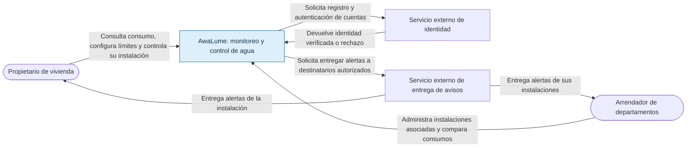
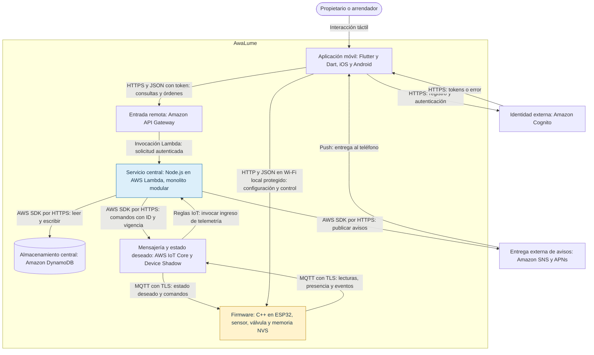
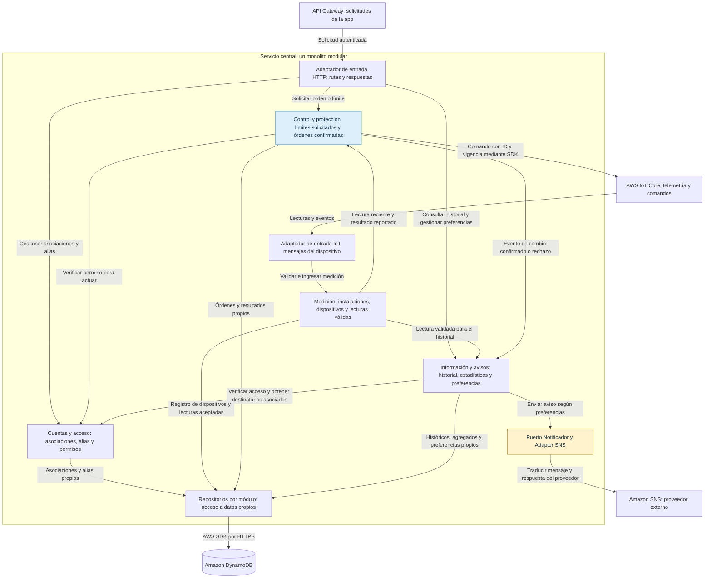

# Arquitectura de AwaLume

**Autor:** Marco Villegas Xanthakis

**Fecha:** 2026-10-29

**Actividad:** Registros de decisión y taller de diagramas · SIS3407

Estos tres niveles describen el diseño académico acordado en la Actividad 2: **monolito modular para el servicio central**, con aplicación móvil y firmware independientes. La decisión y sus costos están en [ADR-001](adr-001-monolito-modular-para-el-servicio-central.md). Se utiliza el lenguaje de codigo mermaid dentro de este archivo para visualizar los diagramas, no son imagenes.

Las tecnologías y restricciones provienen del [README](../../README.md), la [visión del producto](../vision-del-producto.md) y la [especificación de requisitos](../especificacion-requisitos.md). El README describe varias funciones Lambda y stacks de infraestructura; aquí se representa el diseño objetivo de los cuatro módulos centrales bajo una unidad de entrega, no una función o microservicio independiente por módulo.

## 1. Nivel 1: contexto

AwaLume incluye el dispositivo, la aplicación y el servicio central. Los servicios de identidad y entrega de avisos son sistemas externos administrados por proveedores. Este nivel no muestra tecnologías ni componentes internos.

    flowchart LR
    propietario(["Propietario de vivienda"])
    arrendador(["Arrendador de departamentos"])
    sistema["AwaLume: monitoreo y control de agua"]
    identidad["Servicio externo de identidad"]
    avisos["Servicio externo de entrega de avisos"]

    propietario -->|"Consulta consumo, configura límites y controla su instalación"| sistema
    arrendador -->|"Administra instalaciones asociadas y compara consumos"| sistema
    sistema -->|"Solicita registro y autenticación de cuentas"| identidad
    identidad -->|"Devuelve identidad verificada o rechazo"| sistema
    sistema -->|"Solicita entregar alertas a destinatarios autorizados"| avisos
    avisos -->|"Entrega alertas de la instalación"| propietario
    avisos -->|"Entrega alertas de sus instalaciones"| arrendador

    style sistema fill:#DCEFFA,stroke:#0967A8,color:#183247

**Límites del sistema:** una lectura corresponde al punto de instalación, no necesariamente a un departamento. Instalar antes de la cisterna permite controlar su llenado, pero no detener la salida del agua almacenada. No se ofrece localización de fugas ni precisión para facturación.

## 2. Nivel 2: contenedores

Se muestran las unidades de ejecución y almacenamiento, junto con los servicios de infraestructura necesarios para comunicarlas. Los cuatro módulos del servidor no se despliegan como cuatro microservicios. Los servicios administrados externos tampoco son módulos propios.

    flowchart TB
    usuario(["Propietario o arrendador"])
    identidad["Identidad externa: Amazon Cognito"]
    avisos["Entrega externa de avisos: Amazon SNS y APNs"]

    subgraph sistema["AwaLume"]
        app["Aplicación móvil: Flutter y Dart, iOS y Android"]
        entrada["Entrada remota: Amazon API Gateway"]
        central["Servicio central: Node.js en AWS Lambda, monolito modular"]
        datos[("Almacenamiento central: Amazon DynamoDB")]
        enlace["Mensajería y estado deseado: AWS IoT Core y Device Shadow"]
        firmware["Firmware: C++ en ESP32, sensor, válvula y memoria NVS"]
    end

    usuario -->|"Interacción táctil"| app
    app -->|"HTTPS: registro y autenticación"| identidad
    identidad -->|"HTTPS: tokens o error"| app
    app -->|"HTTPS y JSON con token: consultas y órdenes"| entrada
    entrada -->|"Invocación Lambda: solicitud autenticada"| central
    central -->|"AWS SDK por HTTPS: leer y escribir"| datos
    firmware -->|"MQTT con TLS: lecturas, presencia y eventos"| enlace
    enlace -->|"Reglas IoT: invocar ingreso de telemetría"| central
    central -->|"AWS SDK por HTTPS: comandos con ID y vigencia"| enlace
    enlace -->|"MQTT con TLS: estado deseado y comandos"| firmware
    app -->|"HTTP y JSON en Wi-Fi local protegido: configuración y control"| firmware
    central -->|"AWS SDK por HTTPS: publicar avisos"| avisos
    avisos -->|"Push: entrega al teléfono"| app

    style central fill:#DCEFFA,stroke:#0967A8,color:#183247
    style firmware fill:#FFF3CD,stroke:#B8860B,color:#183247
    

- Las flechas de consulta o invocación incluyen sus respuestas por el mismo canal; no se duplican todas para facilitar la lectura. API Gateway valida el token de Cognito y el servicio central verifica además la asociación cuenta-dispositivo (RNF-SEG-001).
- La entrada HTTP y el ingreso por reglas IoT son adaptadores de entrada del mismo diseño central. Su empaquetado debe conservar una versión coordinada del núcleo; el gráfico no afirma que las Lambdas descritas en el README ya estén consolidadas.
- El firmware lee el sensor, calcula flujo y acumulados, evalúa límites y acciona la válvula localmente. La memoria NVS pertenece al dispositivo, no a DynamoDB. Internet, el servicio central y las notificaciones no están en el camino obligatorio del cierre protector (RF-012, RF-013 y RNF-CON-001).
- El control local no necesita una sesión remota vigente, pero sí acceso a la red protegida y comprobación de identidad del equipo (RF-015). El canal local HTTP no se presenta como un canal cifrado HTTPS.
- Una orden remota permanece pendiente hasta recibir confirmación. Abrir requiere estado en línea y un reporte de antigüedad máxima de 7 minutos; la orden vence a los 120 segundos. La protección local conserva prioridad (RF-014, RF-016 y RNF-CON-005).
- La continuidad sin Internet requiere energía, sensor y actuador operativos. No se garantiza cierre durante una pérdida total de alimentación.

## 3. Nivel 3: componentes del servicio central

Este nivel amplía únicamente el contenedor **Servicio central**. Conserva los cuatro módulos de la Actividad 2. Sus responsabilidades son las del lado remoto; las reglas de cierre físico también residen, de forma autónoma, en el firmware y no se trasladan a la nube.

    flowchart TB
    entrada["API Gateway: solicitudes de la app"]
    enlace["AWS IoT Core: telemetría y comandos"]
    datos[("Amazon DynamoDB")]
    sns["Amazon SNS: proveedor externo"]

    subgraph central["Servicio central: un monolito modular"]
        api["Adaptador de entrada HTTP: rutas y respuestas"]
        ingreso["Adaptador de entrada IoT: mensajes del dispositivo"]
        cuentas["Cuentas y acceso: asociaciones, alias y permisos"]
        medicion["Medición: instalaciones, dispositivos y lecturas válidas"]
        control["Control y protección: límites solicitados y órdenes confirmadas"]
        informacion["Información y avisos: historial, estadísticas y preferencias"]
        notificador["Puerto Notificador y Adapter SNS"]
        persistencia["Repositorios por módulo: acceso a datos propios"]
    end

    entrada -->|"Solicitud autenticada"| api
    api -->|"Gestionar asociaciones y alias"| cuentas
    api -->|"Solicitar orden o límite"| control
    api -->|"Consultar historial y gestionar preferencias"| informacion
    enlace -->|"Lecturas y eventos"| ingreso
    ingreso -->|"Validar e ingresar medición"| medicion
    medicion -->|"Lectura reciente y resultado reportado"| control
    medicion -->|"Lectura validada para el historial"| informacion
    control -->|"Verificar permiso para actuar"| cuentas
    informacion -->|"Verificar acceso y obtener destinatarios asociados"| cuentas
    control -->|"Evento de cambio confirmado o rechazo"| informacion
    control -->|"Comando con ID y vigencia mediante SDK"| enlace
    informacion -->|"Enviar aviso según preferencias"| notificador
    notificador -->|"Traducir mensaje y respuesta del proveedor"| sns
    cuentas -->|"Asociaciones y alias propios"| persistencia
    medicion -->|"Registro de dispositivos y lecturas aceptadas"| persistencia
    control -->|"Órdenes y resultados propios"| persistencia
    informacion -->|"Históricos, agregados y preferencias propios"| persistencia
    persistencia -->|"AWS SDK por HTTPS"| datos

    style control fill:#DCEFFA,stroke:#0967A8,color:#183247
    style notificador fill:#FFF3CD,stroke:#B8860B,color:#183247

### Responsabilidades y fronteras

| Módulo de la Actividad 2 | Responsabilidad dentro del servicio central | Colaboración |
|---|---|---|
| Cuentas y acceso | Asociaciones, alias por cuenta y autorización de operaciones sobre dispositivos. Cognito administra credenciales. | Responde a Control e Información mediante interfaces; no expone sus tablas. |
| Medición | Registro de instalaciones/dispositivos y aceptación de lecturas, evitando duplicados y datos atrasados como estado actual. El sensor físico se lee en el firmware. | Entrega lecturas a Control e Información. |
| Control y protección | Valida solicitudes remotas, envía límites y órdenes, distingue pendiente de confirmado y comunica resultados. No sustituye la evaluación local de protecciones. | Consulta permisos a Cuentas, recibe datos de Medición y comunica eventos a Información. |
| Información y avisos | Historial, estadísticas, preferencias y avisos a destinatarios elegibles. | Recibe lecturas/eventos, verifica permisos con Cuentas y usa el puerto Notificador. |

El nodo de persistencia es una abreviatura de repositorios **separados por módulo**, no una puerta para leer datos ajenos. Compartir DynamoDB no autoriza a saltarse las interfaces. Las dependencias se controlan con pruebas y revisión de cambios; no se fuerza el reparto en microservicios solo porque un módulo tenga varios colaboradores.

**Patrones de la Actividad 2:** el Adapter SNS traduce los avisos y errores del proveedor detrás del puerto Notificador. Strategy corresponde al firmware: las protecciones por litros y tiempo ofrecen `debeCerrar(lecturas)` y se evalúan ambas; cualquiera puede exigir el cierre. No se dibuja Strategy como componente del servidor porque la protección no debe depender de él.
